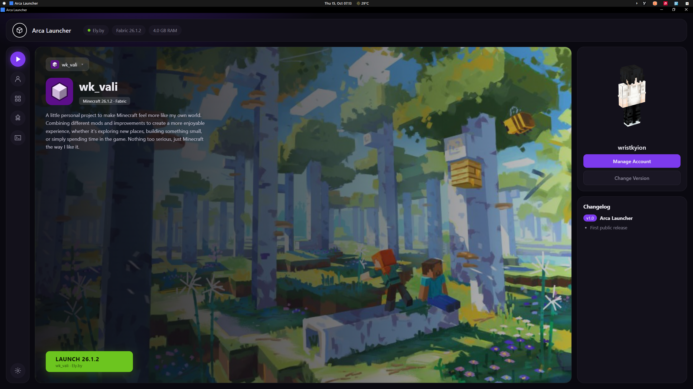
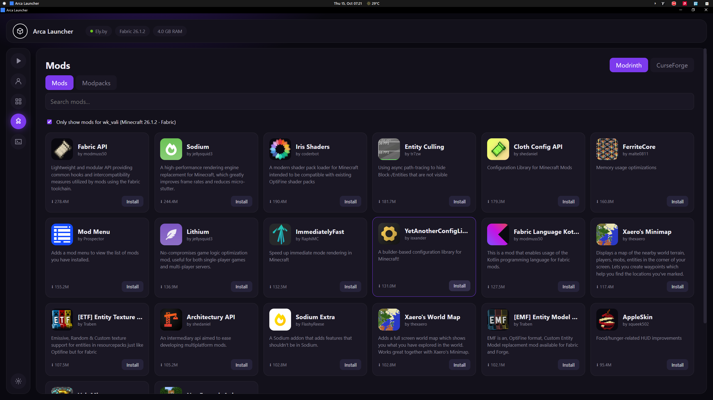
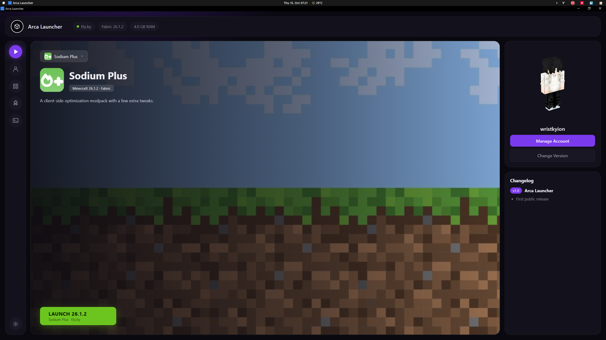

<h1 align="center">Arca-Launcher</h1>

  A custom Minecraft launcher built with Tauri, Vite, Rust, and TypeScript.

Arca-Launcher is an indie project focused on creating a personalized and user-friendly Minecraft launcher with its own design and features.

This project is still in early development, so some features may be incomplete, change over time, or contain bugs.

 <table>
  <tr>
    <td width="33%">
      
    </td>
    <td width="33%">
      
    </td>
    <td width="33%">
      
    </td>
  </tr>
</table>

Features

- Custom Design — A unique interface designed specifically for Arca-Launcher.
- Custom Instances — Create instances with your own name, description, logo, and background.
- Mod & Modpack Downloads — Download supported content from Modrinth and CurseForge.
- Multi-Account Support — Manage Offline, Microsoft, and Ely.by accounts.
- Simple Settings — Configuration designed to be easy to understand, even for beginners.

Built With

- "Tauri" (https://tauri.app/)
- "Vite" (https://vite.dev/)
- "Rust" (https://www.rust-lang.org/)
- "TypeScript" (https://www.typescriptlang.org/)

Arca-Launcher is also my first application developed using this technology stack.

Installation

1. Go to the "Releases" page.
2. Download the latest Arca-Launcher installer for your system.
3. Run the installer and follow the on-screen instructions.
4. Launch Arca-Launcher and enjoy!

Requirements

- WebView2 Runtime — Required to run Arca-Launcher on Windows.

If WebView2 Runtime is not installed on your system, download and install it from the official Microsoft website:

"Download Microsoft Edge WebView2 Runtime" (https://developer.microsoft.com/en-us/microsoft-edge/webview2/)

Notes

- Make sure to download the correct installer from the Releases page.
- If the application fails to start, ensure that WebView2 Runtime is installed and up to date.
- Arca-Launcher is still in early development, so bugs and unexpected behavior may occur.

Bug Reports

Found a bug or have a suggestion? Feel free to report it through the project's "Issues" page.

Please include relevant details, steps to reproduce the problem, and error logs when possible. Never share passwords or authentication tokens.

Development Status

Arca-Launcher is an independent project currently in early development. Features, design, and functionality may change as the project evolves.

Thank you for checking out Arca-Launcher!

---

  <strong>Arca-Launcher</strong>
   
  <em>Made independently, built one step at a time.</em>

