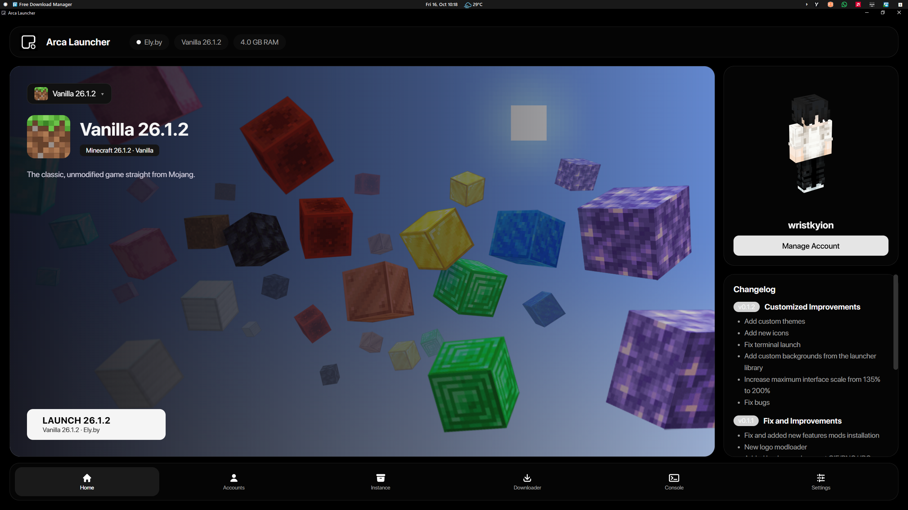
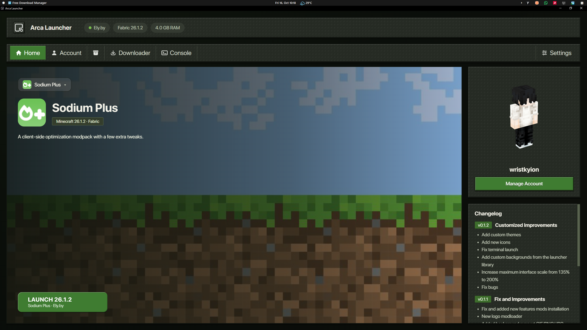
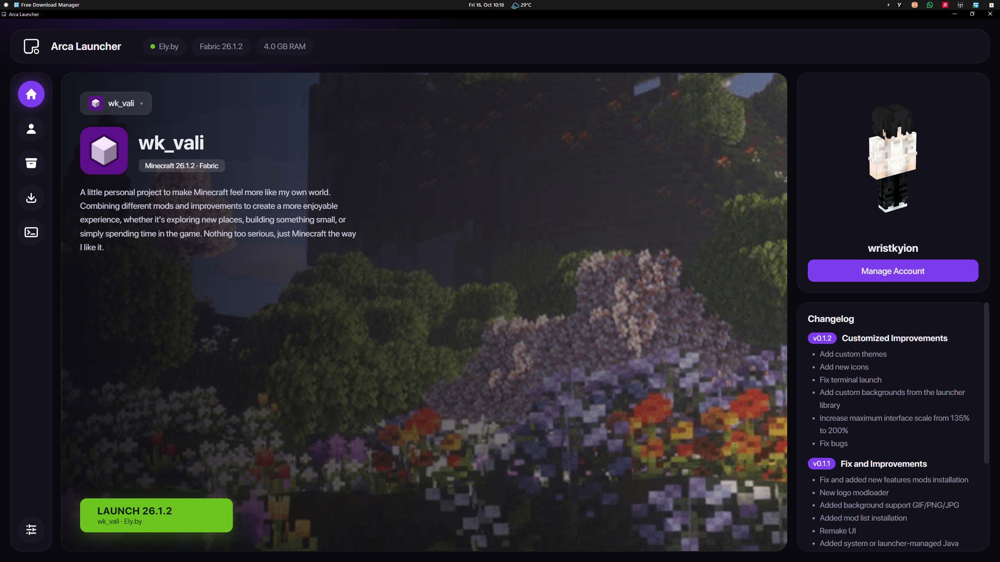

<h1 align="center">Arca Launcher</h1>

> **Project Status: DISCONTINUED**
>
> Arca Launcher is no longer actively maintained. Development has been discontinued as the developer has decided to focus on other projects.
>
> The existing source code remains available for reference, learning, and forking. However, no further updates, bug fixes, or new features are planned.
>
> Thank you to everyone who took an interest in Arca Launcher.

<p align="center">
  A custom Minecraft launcher built with Tauri, Rust, React, and TypeScript.
</p>

Arca Launcher is an independent project for creating and managing Minecraft instances, signing in with supported account types, and browsing game content.

This project is still in early development, so some features may be incomplete, change over time, or contain bugs.

<table>
  <tr>
    <td width="50%" align="center">
      <a href="screenshot/1.png"></a>
    </td>
    <td width="50%" align="center">
      <a href="screenshot/2.png"></a>
    </td>
  </tr>
  <tr>
    <td width="50%" align="center">
      <a href="screenshot/3.png"></a>
    </td>
    <td width="50%" align="center">
      <a href="screenshot/4.png"></a>
    </td>
  </tr>
  <tr>
    <td width="50%" align="center">
      <a href="screenshot/5.png"></a>
    </td>
    <td width="50%" align="center">
      <a href="screenshot/6.png"></a>
    </td>
  </tr>
</table>

> **Early development:** features and setup may change. If you encounter a problem, open an issue and include the steps to reproduce it and the relevant error message. Never post passwords, access tokens, or API keys.

## Features

- Create separate Minecraft instances with custom names, icons, and backgrounds.
- Install Minecraft releases, snapshots, and supported older versions.
- Manage Offline, Ely.by, and Microsoft accounts.
- Browse and install mods, modpacks, resource packs, and shader packs from Modrinth and CurseForge.
- View and manage installed content for each instance.
- Choose system Java or a launcher-managed Java runtime, adjust memory, and configure launch options.
- Customize the launcher with built-in or local CSS themes.

## Changelog

### v0.1.5 — Instances

This release focuses on fixing custom instance path handling, resolving Windows permission issues, and improving instance management and installer behavior.

### Bug Fixes

- Fixed custom instance path handling for Windows device paths (`\\?\`) and DOS device path escaping issues.
- Fixed permission-related errors when running from `Program Files`, including `OS Error 3` and `OS Error 5` when accessing directories or writing settings.

### Features & Improvements

- Improved custom path handling for better compatibility with different storage locations.
- Updated instance management logic to store `instances.json` separately within each Minecraft instance directory, keeping instance configuration files alongside their respective instances.
- Updated NSIS and MSI installer configurations to set the required directory permissions during installation, allowing Arca-Launcher to access its required files and folders more reliably.

## Install a release

1. Open [Arca Launcher releases](https://github.com/wristkyion/Arca-Launcher/releases).
2. Download the latest installer for your operating system. On Windows, use the `.exe` setup installer or `.msi` package.
3. Run the installer and follow its prompts.
4. Start Arca Launcher and follow the first-run setup. You can add an account or create an instance later if you prefer.

### Windows requirement

Arca Launcher requires the **Microsoft Edge WebView2 Runtime**. It is already included on most up-to-date Windows installations. If the launcher reports that it is missing, install the [WebView2 Evergreen Runtime](https://developer.microsoft.com/en-us/microsoft-edge/webview2/), then reopen the launcher.

## Build from source

### Requirements

- Git
- [Node.js](https://nodejs.org/) 18 or newer (includes npm)
- [Rust](https://www.rust-lang.org/tools/install) stable toolchain
- Windows: [Visual Studio Build Tools](https://visualstudio.microsoft.com/visual-cpp-build-tools/) with **Desktop development with C++** and a Windows SDK
- Windows: WebView2 Runtime

For macOS or Linux, install the native prerequisites listed in the [Tauri v2 prerequisites guide](https://v2.tauri.app/start/prerequisites/).

### Clone and install dependencies

```powershell
git clone https://github.com/wristkyion/Arca-Launcher.git
Set-Location Arca-Launcher
npm ci
```

### Run the desktop app in development

Publisher settings are needed to test Microsoft login and CurseForge. If you omit them, the rest of the launcher can still be developed, but those integrations will report that they are not configured.

```powershell
$env:ARCA_MICROSOFT_CLIENT_ID = "<publisher-application-client-id>"
$env:ARCA_CURSEFORGE_PROXY_URL = "https://<publisher-worker>.workers.dev/v1"
npm run tauri dev
```

To run only the frontend in a browser while working on UI code, use `npm run dev`. Native Tauri commands will not be available in browser-only mode.

### Build an installer

Set the same publisher configuration in the build shell, then run:

```powershell
$env:ARCA_MICROSOFT_CLIENT_ID = "<publisher-application-client-id>"
$env:ARCA_CURSEFORGE_PROXY_URL = "https://<publisher-worker>.workers.dev/v1"
npm run tauri build
```

On Windows, Tauri writes the generated installers under `src-tauri\target\release\bundle\`. Look in the `nsis` and `msi` subfolders for the `.exe` and `.msi` packages. Both installers configure write access for the launcher data folders.

Useful checks:

```powershell
npm run build
cargo check --manifest-path src-tauri\Cargo.toml
cargo test --manifest-path src-tauri\Cargo.toml
node --test services\curseforge-proxy\src\index.test.js
```

## Publisher integration setup

These steps are for the launcher publisher or developers building a configured release. **End users do not need to enter credentials.** Do not commit secrets or send them in chat.

### Microsoft sign-in

Microsoft device-code sign-in requires a registered public-client application:

1. In the [Microsoft Entra admin center](https://entra.microsoft.com/), create an app registration. Choose **Personal Microsoft accounts only** for the launcher's current `/consumers` sign-in endpoint.
2. In **Authentication**, enable **Allow public client flows**. Add **Mobile and desktop applications** if the portal requires a platform configuration. Device-code flow does not use a redirect URI.
3. Do not create or distribute a client secret. Copy the **Application (client) ID** and provide it to the build as `ARCA_MICROSOFT_CLIENT_ID`.

Microsoft's [device-code flow documentation](https://learn.microsoft.com/en-us/entra/identity-platform/v2-oauth2-device-code) describes the public-client requirements.

### CurseForge integration

CurseForge requires an API key approved for the publisher's use. The key is stored as a secret in the publisher-operated Cloudflare Worker and is never embedded in the launcher.

1. Apply for API access through the [CurseForge for Studios API documentation](https://docs.curseforge.com/). Confirm that the issued key is approved and active.
2. Install Wrangler and authenticate to the publisher's Cloudflare account:

   ```powershell
   npx wrangler@latest login
   ```

3. From the repository root, move to the Worker directory, save the key as a Worker secret, and deploy:

   ```powershell
   Set-Location services\curseforge-proxy
   npx wrangler@latest secret put CURSEFORGE_API_KEY
   npx wrangler@latest deploy
   ```

   Enter the API key only at Wrangler's hidden prompt. Never paste it into the launcher, source files, or a public repository.

4. Set `ARCA_CURSEFORGE_PROXY_URL` to the deployed Worker URL, optionally ending it with `/v1`. For example:

   ```powershell
   $env:ARCA_CURSEFORGE_PROXY_URL = "https://<worker>.<account>.workers.dev/v1"
   ```

5. Protect the public Worker endpoint with Cloudflare rate limiting and monitor usage and the CurseForge API quota. The allowlist limits which CurseForge API routes the Worker forwards, but the Worker URL itself is public.

When the Worker secret changes, redeploying the app is not required. If the Microsoft client ID or proxy URL changes, restart development/build with the updated environment variables.

## Custom themes

Built-in themes are in `assets/themes/`. To add a local theme, create a `.css` file in `launcher/themes/` beside the launcher's `launcher/config` folder, then select **Reload themes** in Settings. Optional theme metadata can be placed in a CSS comment:

```css
/*
Name: My Theme
Author: Your Name
*/

:root {
  --bg: #101116;
  --panel: #15161d;
  --panel2: #1c1e26;
  --line: rgba(255, 255, 255, .09);
  --purple: #64748b;
  --green: #94a3b8;
  --text: #e8eaf0;
  --mute: #9a9eaa;
}
```

## Support

Report bugs or request features through the repository's [Issues](https://github.com/wristkyion/Arca-Launcher/issues). Include your operating system, what you were doing, and the exact error text. Redact usernames, file paths, authentication codes, passwords, access tokens, and API keys from logs or screenshots.

---

<p align="center">
  <strong>Arca Launcher</strong><br />
  <em>Made independently, built one step at a time.</em>
</p>
